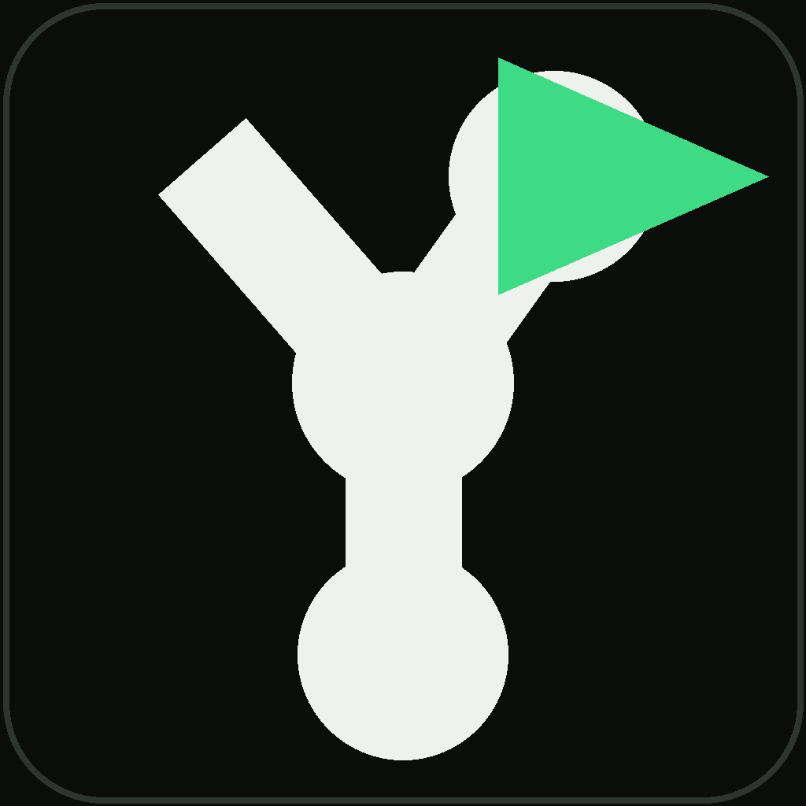
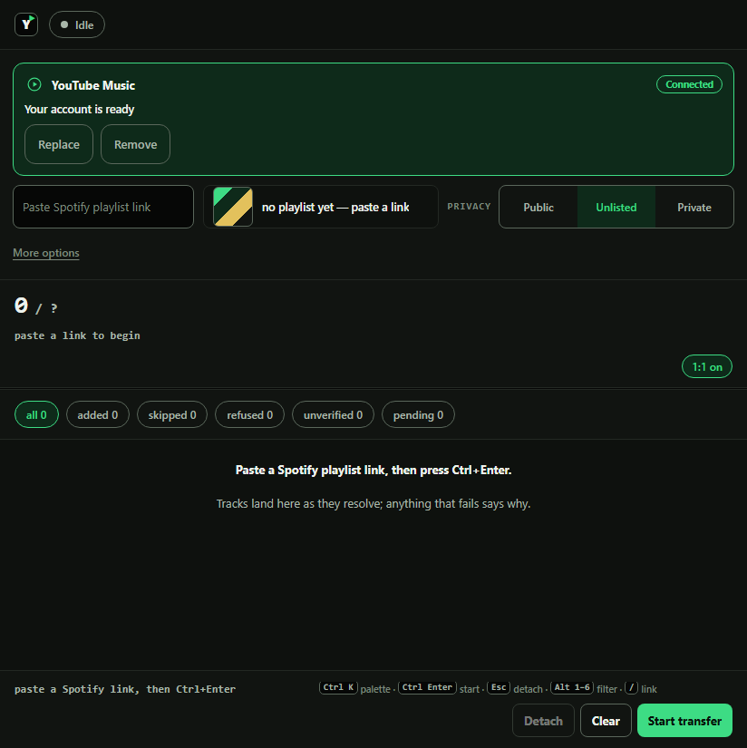
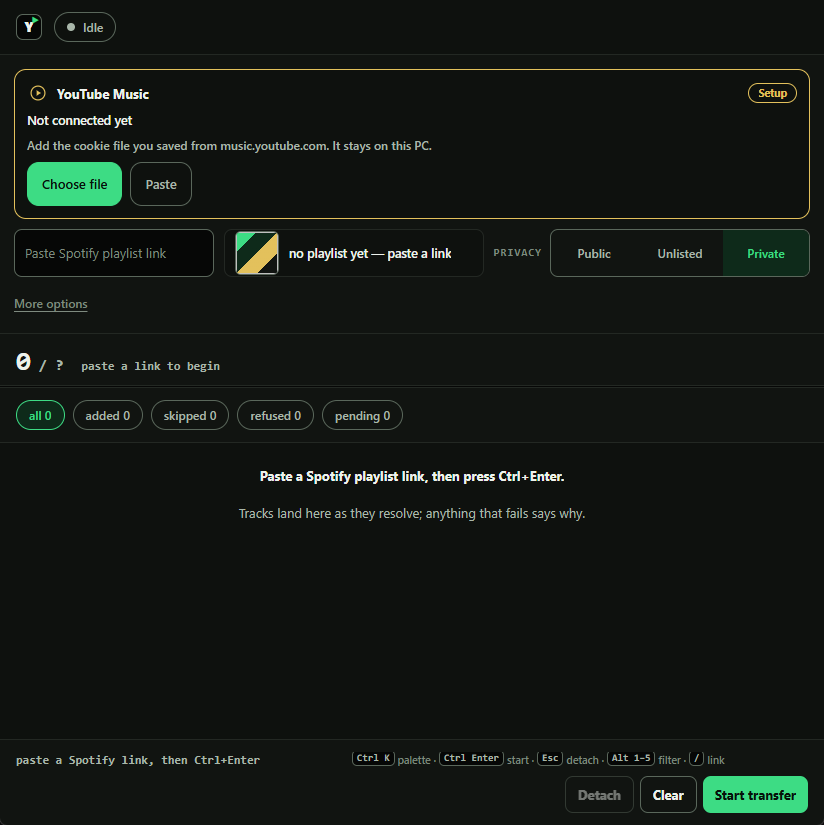

<p align="center">
  
</p>
<h1 align="center">sp2yt</h1>
<p align="center"><strong>Copy a public Spotify playlist into YouTube Music without an API key.</strong></p>

<p align="center">
  
</p>

## Install

Download `sp2yt.exe` from the [latest release](https://github.com/nathwn12/spotify-playlist-to-youtube/releases/latest) and run it. One portable executable — no installer, no Python, no console window.

Windows 10/11 x64, with the Microsoft Edge WebView2 runtime (it ships with Edge). The exe is not code-signed, so the first launch trips SmartScreen ("Windows protected your PC"): choose More info, then Run anyway.

### Offline or pinned

`python3 backend.py`, then open http://127.0.0.1:8787. Python 3.10+ with the standard library only — nothing to install.

Pin an exact version:

```bat
git clone https://github.com/nathwn12/spotify-playlist-to-youtube
cd spotify-playlist-to-youtube
git checkout v0.2.1
```

## Use it

Two steps: the first runs once, the second runs every transfer.

<p align="center">
  
  <br /><sub>First run: the card asks for your cookie file once, and the cookie never leaves this PC.</sub>
</p>

1. Connect YouTube Music. The card finds `music.youtube.com_cookies.txt` on your Desktop or in Downloads and offers it; choose the file, or paste its header instead. Once it is connected, `Replace` and `Remove` sit on the card — `Remove` clears the saved cookie, and it stays removed until you choose a file again.
2. Paste a public Spotify link, choose the privacy (Private is the default), then press Start transfer (or `Ctrl+Enter`). The counter moves against Spotify's declared track count, and the new playlist appears as a chip in the top bar, linked to its `music.youtube.com/playlist?list=` page.

If the card does not find a file by itself, choose it by hand — an export from a cookie extension works the same way. `More options` holds the watch folder (one extra folder) and the copy button.

`Ctrl+K` palette (start, stop, filters, copy, jump) · `Ctrl+Enter` start · `Esc` stop · `Alt+1…5` outcome filter · `/` focus the link field · `j`/`k` scroll the ledger · `Ctrl+Shift+N` new transfer. Reloading mid-run re-attaches and the counter never moves backwards.

## What you get

- A ledger row per track, each with its reason.
- A landed count read back from YouTube Music and reconciled against the playlist's entries.
- Repeats preserved: three copies in, three entries out.
- Resume instead of duplicates when the same playlist runs again.
- No keys and no cloud: everything on 127.0.0.1.

## Configure it

| Setting | Where | Default | Notes |
|---|---|---|---|
| Privacy | Side rail | Private (`PRIVATE`/`UNLISTED`/`PUBLIC`) | Persisted server-side in the app's per-user data folder as `sp2yt/settings.json` |
| YouTube Music cookie | Connect card | Unset | Auto-detected from Desktop or Downloads, or chosen by hand; held DPAPI-encrypted so it survives a restart; `Remove` on the card clears it |
| Watch folder | `More options` | Desktop and Downloads | One extra folder; regenerated exports re-latch by content |
| Port | Fixed | `8787` | Bound to 127.0.0.1 only |
| Settings API | `GET`/`POST /api/settings` | `{"privacy": "PRIVATE"}` | Only privacy is persisted; unknown keys are ignored |

The cookie is never logged — audit lines record lengths and flags only. `python3 watchdog.py` reads that audit trail and prints the fix for the latest failure (`--watch` repeats every 15 seconds).

## How it works

- Spotify read runs through the web player's keyless token (TOTP from the player bundle, memory only) plus the api-partner playlist query, paged 100 at a time past the embed cap. Fewer tracks than Spotify declares fails the run before YouTube is touched.
- YouTube Music search runs through InnerTube `WEB_REMIX` with the public web client key — no quota, no billing.
- Titles match across scripts: a Japanese-script spelling and its romaji — or the reverse — align, so either spelling of the same track finds it. A row whose spellings cross scripts and still has no confident match is added anyway, as a labelled best guess, and the ledger says `best guess` on it.
- A newly created playlist inherits the Spotify cover when YouTube Music accepts it. The upload is best-effort: a failed cover is silent and never affects the transfer.
- YouTube Music write creates the playlist and appends with your cookie (`SAPISIDHASH` derived locally per call, never stored).

Both surfaces are unofficial: a shape change stops the run with a parse or auth diagnosis and a hint, instead of writing a wrong playlist.

## Requirements

- Windows 10/11 x64 for the exe, with WebView2 from Edge.
- Python 3.10+ standard library only for the source route.
- A `music.youtube.com` cookie for the account that should own the playlist.
- A public Spotify playlist.

## Development

Four files: `backend.py` (server and transfer logic), `index.html` (page), `app.py` (WebView2 shell), `watchdog.py` (diagnosis).

- Dev lane: `sp2yt-start.cmd` serves the source at `http://127.0.0.1:8787`.
- Build lane: `build.cmd` (needs `pyinstaller` and `pywebview`) backs up the exe, compiles one portable exe, smoke-tests `/health`, keeps green and restores on red.
- Acceptance gate: `acceptance.cmd` must print `36/36 fixtures` and parse-check the page script.
- Re-record: `python3 tests\record_fixtures.py <public playlist url>` — at most 40 real searches, 300 ms apart; everything after runs offline.

## Limits

- Public Spotify playlists only — no Spotify login.
- YouTube Music caps playlists at 5,000 tracks.
- Auto-match ran at about 90% on the playlist this was built against; every miss is listed with its reason.
- The cookie expires: a 401 stops the run and asks for a fresh export.

## Status

Experimental and still moving. It works today, but it is not a finished product:
interfaces may change, features may be improved or removed, and a release can
break the one before it. This is maintained by one person, not a team. If it
breaks, open an issue with the command you ran and what you saw.

## Links

- [Releases](https://github.com/nathwn12/spotify-playlist-to-youtube/releases) — the portable `sp2yt.exe`.
- [Issues](https://github.com/nathwn12/spotify-playlist-to-youtube/issues) — report a break with the command you ran and what you saw.
- [MIT licence](LICENSE)

<!-- nathwn12 house footer: identical in every repo. Do not edit. -->
<p align="center">
  <a href="https://github.com/nathwn12"></a>
</p>
<p align="center">
  <sub>Built by <a href="https://github.com/nathwn12">nathwn12</a> · <a href="https://github.com/nathwn12?tab=repositories">All projects</a></sub>
</p>
