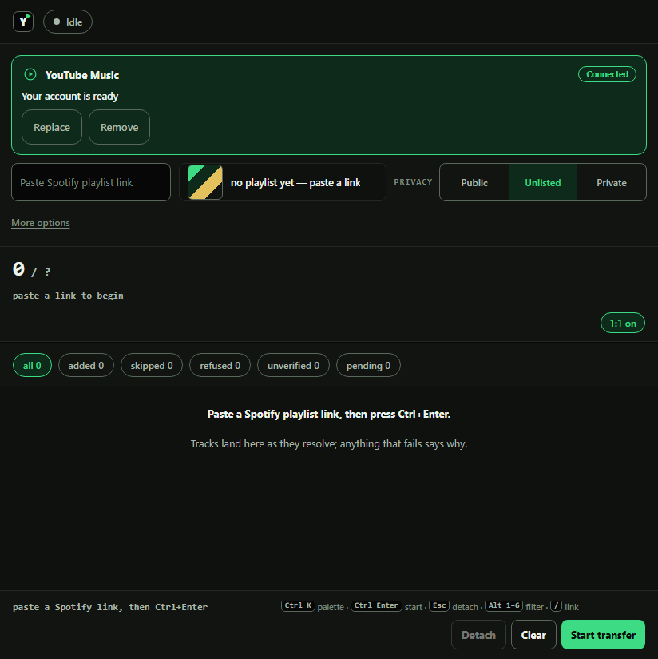

<p align="center">
  
</p>
<h1 align="center">sp2yt</h1>
<p align="center"><strong>Copy a public Spotify playlist into YouTube Music without an API key.</strong></p>

<p align="center">
  
</p>

## Install

Download `sp2yt.exe` from the [latest release](https://github.com/nathwn12/spotify-playlist-to-youtube/releases/latest) and run it. One portable executable — no installer, no Python, no console window.

Windows 10/11 x64, with the Microsoft Edge WebView2 runtime (it ships with Edge). The exe is not code-signed, so the first launch trips SmartScreen ("Windows protected your PC"): choose More info, then Run anyway.

### From source or pinned

`sp2yt-start.cmd`, or `python3 backend.py`, then open http://127.0.0.1:8787. Python 3.12+ with the standard library only — nothing to install.

Pin an exact version:

```bat
git clone https://github.com/nathwn12/spotify-playlist-to-youtube
cd spotify-playlist-to-youtube
git checkout v0.5.1
```

## Use it

Two steps: the first runs once, the second runs every transfer.

1. Connect YouTube Music. The card finds `music.youtube.com_cookies.txt` on your Desktop or in Downloads and offers it; choose the file, or paste its header instead. Once it is connected, `Replace` and `Remove` sit on the card — `Remove` clears the saved cookie, and it stays removed until you choose a file again. ([First-run screen](assets/app-setup.png))
2. Paste a public Spotify link, choose the privacy (Private is the default), then press Start transfer (or `Ctrl+Enter`). The counter moves against Spotify's declared track count, and the new playlist appears as a chip in the top bar, linked to its `music.youtube.com/playlist?list=` page.

If the card does not find a file by itself, choose it by hand — an export from a cookie extension works the same way. `More options` holds the watch folder (one extra folder) and Copy rows.

`Ctrl+K` palette · `Ctrl+Enter` start · `Esc` detach, which leaves the transfer running on the server · `Alt+1…6` outcome filter · `/` focus the link field · `j`/`k` scroll the ledger · `Ctrl+Shift+N` new transfer. Reloading or `Ctrl+Enter` re-attaches to a detached run.

## What you get

- A ledger row per track, each with its reason.
- A landed count read back from YouTube Music and reconciled against the playlist's entries.
- Repeats kept separate: an add asks YouTube Music to keep a second copy, and two source rows are never merged into one. A repeat the server refuses anyway is listed as `duplicate`, not silently dropped.
- Resume instead of duplicates when the same playlist runs again.
- No API keys, and nothing of yours between you and the sites: the page and the transfer service run on 127.0.0.1, and the tracks, searches and writes go straight to Spotify and YouTube Music over HTTPS.

## When a write is uncertain

A write whose outcome is unknown — a timeout, a dropped connection, a 5xx, a 429 — is never re-sent automatically. The run stops and says so, and the doubt is written to disk so that a resume cannot resend it either.

Check the playlist by hand. Do not Reset, do not delete the playlist, and do not delete `created.json`: that record is the only copy of the plan and the playlist link. [PROTOCOL.md](PROTOCOL.md#6-when-a-write-is-uncertain) states the rule in full.

## Configure it

| Setting | Where | Default | Notes |
|---|---|---|---|
| Privacy | Side rail | Private (`PRIVATE`/`UNLISTED`/`PUBLIC`) | Persisted server-side in the app's per-user data folder as `sp2yt/settings.json` |
| YouTube Music cookie | Connect card | Unset | Auto-detected from Desktop or Downloads, or chosen by hand; held DPAPI-encrypted so it survives a restart; `Remove` on the card clears it |
| Watch folder | `More options` | Desktop and Downloads | One extra folder; regenerated exports re-latch by content |
| Port | Fixed | `8787` | Bound to 127.0.0.1 only |

The cookie is never logged — audit lines record lengths and flags only.

## How it works

- The Spotify read is keyless: the public embed for metadata, then the web player's own token against the api-partner playlist query, 100 tracks per page. A read short of the declared track count fails before YouTube Music is touched.
- YouTube Music search runs through InnerTube `WEB_REMIX` with the public web client key. Titles match across scripts, and a row with no identified match is skipped with its reason rather than guessed.
- The write goes out in slices of 100, each proved by the playlist read that shows it. `added` counts a copy a read proved present; a copy sent but not yet proved is `pending`.
- A newly created playlist inherits the Spotify cover when YouTube Music accepts it — best effort, and never a failed run.

[PROTOCOL.md](PROTOCOL.md) carries the full protocol, the recovery rules, the local API and the measured costs.

## Limits

- Public Spotify playlists only — no Spotify login.
- YouTube Music caps playlists at 5,000 tracks.
- Auto-match ran at about 90 % on the playlist this was built against; every miss is listed with its reason.
- The cookie expires: a 401 stops the run and asks for a fresh export.
- An interrupted or unattributed write can require a manual playlist check.
- Both surfaces are unofficial. A failure the app recognizes stops the run with a diagnosis and a hint (`parse`, `auth`, `source`, `throttle`, `transient`, `write`), and one it does not recognize is reported as `unknown` with the raw error line, so a run stops rather than writing on a guess. A change that raises nothing is not detected: matching is best-effort, so the ledger's reasons are the evidence.

## Status

**Unverified** — as-is, use at your own risk. The cover upload and cross-script matching are best-effort, and a 1,100-song transfer has not been verified end to end. Verify a transfer before relying on it.

## Development

Four files: `backend.py` (server and transfer logic), `index.html` (page), `app.py` (WebView2 shell), `watchdog.py` (diagnosis). `AGENTS.md` holds the invariants, `PROTOCOL.md` the protocol.

- Dev lane: `sp2yt-start.cmd` serves the source at http://127.0.0.1:8787.
- Build lane: `build.cmd` (needs `pyinstaller` and `pywebview`) backs up the exe, compiles one portable exe, smoke-tests `/health`, keeps green and restores on red.
- Gate: `acceptance.cmd` must print `36/36 fixtures` and pass the language, counts, editions, order, cover, page-parse, UI, cookie, connect-card and release-asset checks.
- Lint: `python3 -m ruff check .`

## Links

- [Releases](https://github.com/nathwn12/spotify-playlist-to-youtube/releases) — the portable `sp2yt.exe`.
- [Issues](https://github.com/nathwn12/spotify-playlist-to-youtube/issues) — report a break with the command you ran and what you saw.
- [MIT licence](LICENSE)
